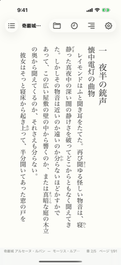

# EbookViewer

EPUB / MOBI / AZW3 とコミック (CBZ / CBR / PDF / 画像フォルダー) に対応した、縦書き日本語対応の電子書籍ビューアーです。
Swift / SwiftUI で作られており、macOS 14 以降と iOS / iPadOS 17 以降で動きます。

## できること

- **縦書きの日本語組版** — ルビ、圏点、縦中横、割注、字下げ・字詰めに対応します。本文の組版には日本語組版エンジン [stone_engine](https://github.com/sanpu-ya/stone_engine) を使っています
- **青空文庫の注記** — 注記から変換された本文の class を読み取り、見た目に反映します
- **対応形式** — 電子書籍は EPUB 2 / 3、KF8 (`.azw3` `.kf8`)、MOBI (`.mobi` `.prc` `.azw`)。コミックは `.cbz` / `.zip`、`.cbr` / `.rar`、`.pdf`、画像フォルダー。DRM 付きのファイルは開けません
- **読書位置の記憶** — 書籍ごとに章とページの位置を覚え、次に開いたときに続きから読めます
- **表示の設定** — テーマ (明るい / セピア / 暗い)、明朝・ゴシック、文字サイズ、行間、余白を切り替えられます

## ドキュメント

- [操作と画面](ui.md) — キー割り当て、表示の設定、コミックの操作、設定と読書位置の保存先
- [実装のしくみ](implementation.md) — 対応形式の詳細、縦書き組版と注記の対応、ソース構成、テストで確認していること
- [プライバシーポリシー](privacy.md) — 本アプリは情報を収集しません

## ソースコード

[github.com/sanpu-ya/EbookViewer](https://github.com/sanpu-ya/EbookViewer) で公開しています。MIT License です。

ビルド方法や利用しているソフトウェアのライセンスは、リポジトリの README をご覧ください。
